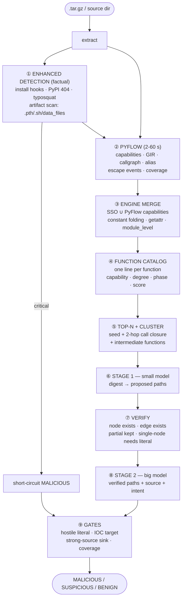
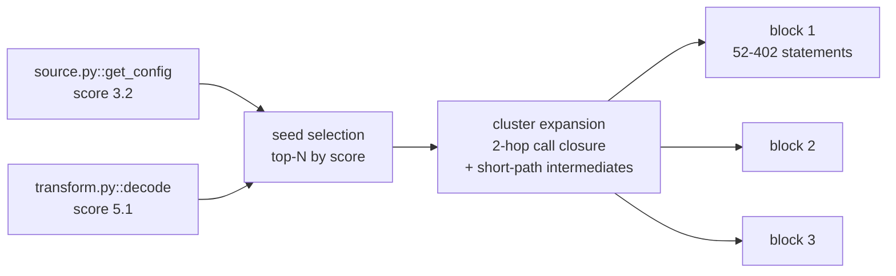
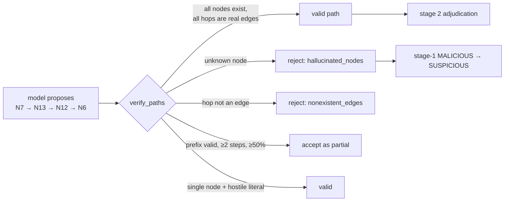
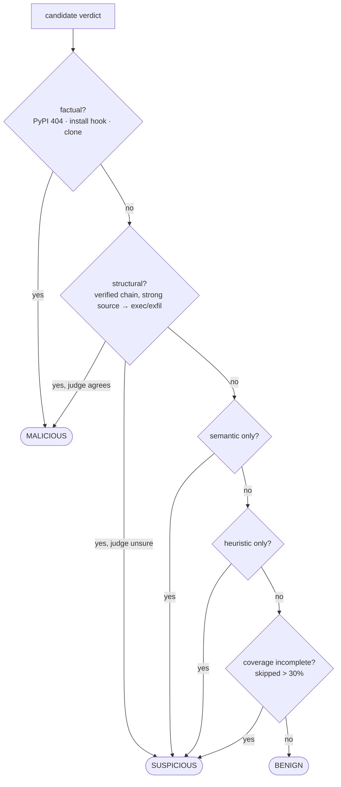
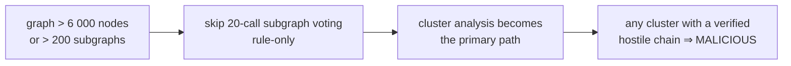
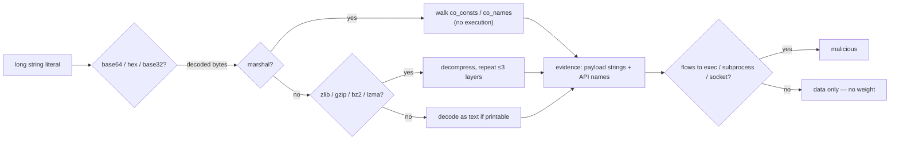
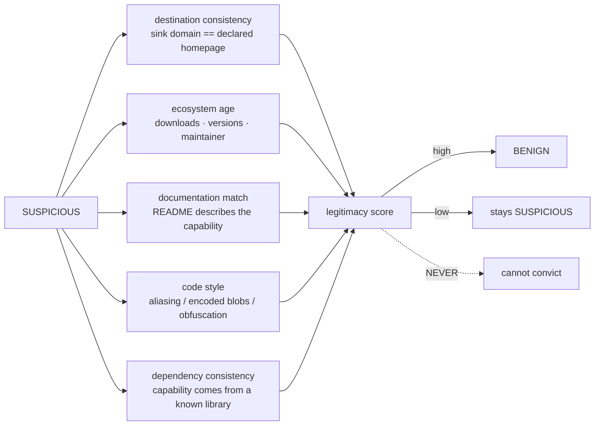

# NEW_DDG v3 Architecture — Data Flow & Runtime

This page shows how data actually moves through the system, with the artifacts
each stage produces and consumes. For the narrative and evaluation, see the
[README](../README.md) ([中文](../README_zh.md)).

## 1. End-to-end pipeline



Every stage writes to `{pkg}/.ddg_output/`, so offline re-judgment can reuse the
artifacts without re-running analysis.

## 2. What each stage produces

| Stage | Output | Consumed by |
|---|---|---|
| ① enhanced detection | `enhanced_report` (threats, install hooks, registry status) | short-circuit; gates |
| ② PyFlow | `capabilities` (findings, coverage, escape), `GIR` (statements), `callgraph` | ③ |
| ③ merge | `nodes[]` (code, capability, phase, escape_to), `edges[]` (data/call/return/control/param) | ④⑤ |
| ④ catalog | `[{file, name, lines, stmt, caps, in, out, phase, score, reasons}]` | ⑤ |
| ⑤ clusters | `[{label, nodes, edges, boundary_edges, cluster}]` | ⑥ |
| ⑥ stage 1 | proposed paths (short node IDs), verdict | ⑦ |
| ⑦ verify | valid paths (real IDs), rejected paths + reasons | ⑧ |
| ⑧ stage 2 | per-path judgments, overall verdict | ⑨ |
| ⑨ gates | final category + audit fields | JSON output |

## 3. Node and edge schema

```python
node = {
  'node_id': 'pkg/setup.py:7:0',      # rel:line:col — unique per statement
  'file': '/abs/path/pkg/setup.py',   # absolute: digest._source_line needs it
  'line': 7, 'type': 'object_call_stmt',
  'code': "_ttmp.write(b\"...urlopen(...)...exec(...)\")",
  'function_name': '<module>' | 'run',
  'capability': 'process_spawn' | 'code_eval' | 'credential_access' | None,
  'is_dangerous': True, 'severity': 'critical',
  'phase': 'install' | 'import' | 'runtime',
  'module_level': True,
  'escape_to': ['builtins.map'], 'escape_kind': ['argument'],
}

edge = {
  'from_node': 'pkg/main.py:4:11', 'to_node': 'pkg/transform.py:3:0',
  'kind': 'call' | 'return' | 'param' | 'data' | 'control',
  'variable': 'decode',
  'from_file': '...', 'to_file': '...', 'is_cross_file': True,
}
```

Edge kinds and who consumes them:

| kind | Meaning | Taint | Digest | Boundary |
|---|---|---|---|---|
| `data` | value def → use within a function | ✅ | ✅ | ✅ |
| `call` | call statement → callee entry | ✅ | ✅ | ✅ |
| `return` | callee return → call statement | ✅ | ✅ | ✅ |
| `param` | escaping value → callee entry (escape events) | ✅ | ✅ | ✅ |
| `control` | statement order (`next_stmt`) | ❌ excluded | ✅ STRUCT-EDGES | ❌ |

`control` is deliberately excluded from taint: control dependency is not data
dependency, and letting it through produced false chains where a literal-argument
sink was never reached by tainted data.

## 4. Cluster delivery



Why clusters: if function `A` reads credentials and function `B` posts them, each
looks benign alone. Delivering them separately reproduces the split-attack failure
the design exists to prevent.

## 5. Anti-hallucination contract



Node IDs are assigned by `md5(node_id)` sort, not graph order, so a model cannot
produce a plausible-looking sequence by counting upward.

## 6. Evidence gates



Two invariants:

- **Heuristic evidence never convicts.** Regex hits and weak chains
  (`file_read → exec`, the setuptools-scm idiom) stop at SUSPICIOUS.
- **Unknown ≠ safe.** If the analyzer skipped more than the configured fraction of
  entries and no Tier-1 capability was found, BENIGN is forbidden.

## 7. Large-package path



Measured: a 1 306-file package now completes in ~60 s (PyFlow budget) where the
hand-written builder needed 40 minutes and still timed out.

## 8. Registry channel relationship

The registry channel (PyPI 404, typosquat index, duplicate clone) is a separate,
factual-evidence channel. It catches **pure name-squatting with clean copied
code**, which the graph channel deliberately refuses to convict. The two channels
are complementary:

| Channel | Catches | Cannot catch |
|---|---|---|
| Graph + LLM | real-name packages with injected code (XMRig-mined `requess`) | clean-copy name-squats |
| Registry | name-squats, takedowns, clones | real-name injected-code packages |
| **Union** | **both classes** | — |

## 9. Obfuscation handling



Decoded output is never executed — only regex-scanned and shown to the judge.

## 10. Planned: legitimacy channel

The 7 % benign SUSPICIOUS are packages that genuinely exercise malicious-grade
capability (`intuit_oauth` handles OAuth credentials, `nvgpu` calls into native GPU
libraries). They stay SUSPICIOUS because the system currently collects only
*negative* evidence.



The symmetry matters: adversarial evidence may raise a verdict to MALICIOUS,
legitimacy evidence may lower it to BENIGN, and neither may do the other's job.
