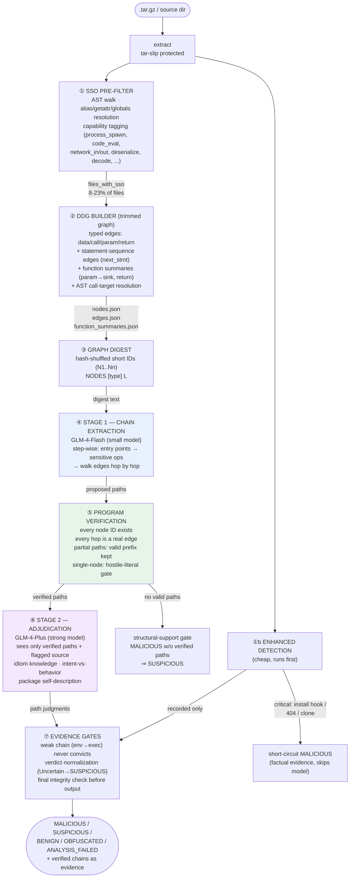
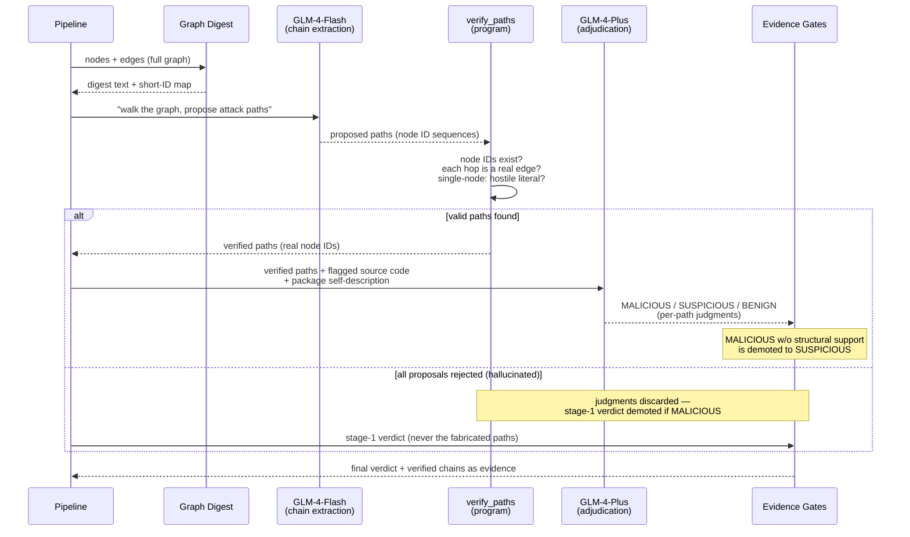
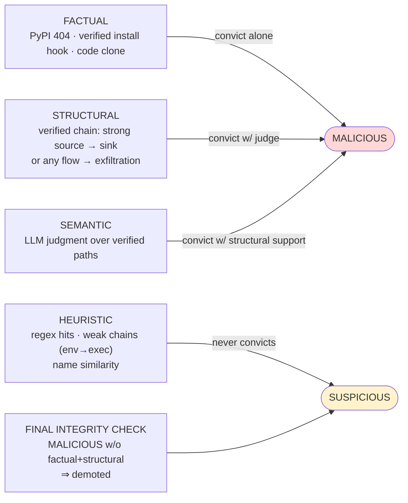
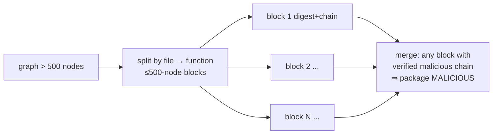

# NEW_DDG Architecture — Data Flow & Runtime

This page shows how data actually moves through the system, with the artifacts
each stage produces and consumes. For the narrative and evaluation, see the
[README](../README.md) ([中文](../README_zh.md)).

## 1. End-to-end pipeline

Artifacts are shown on arrows; every stage writes files to
`{pkg}/.ddg_output/` which later stages (and offline re-judgment) consume.

## 2. Two-stage interaction (per package)

## 3. Evidence grading (what can convict)

## 4. Large-package path (Phase A, integration pending)

Status: implemented in `src/package_graph_analysis.py`, main-loop integration pending —
this is Phase A of the roadmap.

## 5. Registry channel relationship

The registry channel (PyPI 404, typosquat index, duplicate clone) is a
separate, factual-evidence channel. It catches **pure name-squatting with
clean copied code**, which the graph channel deliberately refuses to convict.
The two channels are complementary — measured on the 500-package corpus:

| Channel | Catches | Cannot catch |
|---|---|---|
| Graph + LLM | real-name packages with injected code (XMRig-mined `requess`) | clean-copy name-squats |
| Registry | name-squats, takedowns, clones | real-name injected-code packages |
| **Union** | **both classes** | — |
